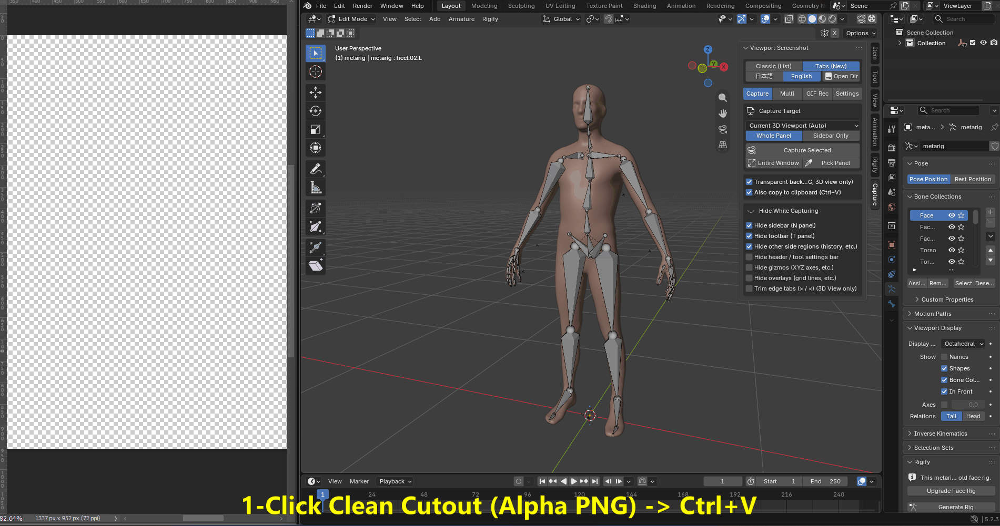

# Viewport Screenshot for Blender (Free Edition)

*(Note: Demo above shows **Pro Edition v1.2.6** features including Alpha PNG, Multi-Panel Composite & Live GIF Recording. See the comparison table below for Free vs. Pro differences.)*

> **Capture clean Blender viewports in one click — no manual UI hiding or cropping required.**

A lightweight, zero-dependency Blender add-on to capture clean 3D viewport screenshots with a single click.

🔥 **Launch Sale Active (until Nov 29):**
Check out the **Pro Edition (v1.2.6)**—now featuring **Real-Time 3D Viewport GIF Recording**, **Multi-Panel Composite**, **Full Window Capture**, **Transparent Background (Alpha PNG)**, and **Direct Clipboard Copy (`Ctrl+V`)**—on [Gumroad (Global)](https://mashitaya.gumroad.com/l/tdgmq/LAUNCH) or [BOOTH (Japan)](https://yworks.booth.pm/items/9112055).

---

## ⚡ Features (Free Edition)

* **One-Click Clean Capture:** Snap your active 3D Viewport from the top-right header camera icon or the Sidebar (`N` key > **Capture** tab).
* **Auto-Hide UI Clutter:** Temporarily hides sidebars, headers, and overlays while capturing, then restores your workspace automatically.
* **Zero External Dependencies:** Built purely on Blender's native Python API (no extra packages needed).
* **Lightweight & Portable:** Single `.py` add-on file—easy to install and use.
* **Compatibility:** Tested on **Blender 3.2 and newer (Blender 3.2 – 5.x)** on Windows, macOS, and Linux.

## 🚀 How to Install & Use

Since the Free Edition is provided as a standalone Python add-on (`viewport_screenshot_blender_free.py`), follow these steps to install it in Blender:

1. Download [`viewport_screenshot_blender_free.py`](./viewport_screenshot_blender_free.py) from this repository.
   *(If you downloaded the repository as a ZIP via **Code > Download ZIP**, extract it first so you can select the `.py` file).*
2. Open Blender and go to **Edit > Preferences > Add-ons**.
3. Click **Install...** at the top right.
   *(In **Blender 4.2 and newer**, click the top-right down-arrow icon `v` > **Install from Disk...**).*
4. Navigate to the downloaded `viewport_screenshot_blender_free.py` and click **Install Add-on**.
5. Enable the checkbox next to **3D View: Viewport Screenshot**.
6. Click the **camera icon** in the top-right header of the 3D Viewport (or open **Sidebar `N` > Capture**) to take a clean screenshot!

## ⚖️ Free vs. Pro Comparison

| Feature | Free Edition | Pro Edition (v1.2.6) |
| :--- | :---: | :---: |
| One-Click 3D Viewport Capture | ✅ | ✅ |
| Basic Auto-Hide UI & Overlays | ✅ | ✅ |
| **Real-Time 3D Viewport GIF Recording (Cursor & Timer)** | ❌ | ✅ |
| **Multi-Panel Composite & Full Blender Window Capture** | ❌ | ✅ |
| **Transparent Background (Alpha PNG Cutout)** | ❌ | ✅ |
| **Direct OS Clipboard Copy (`Ctrl+V` into Photoshop/Discord)** | ❌ | ✅ |
| **Capture Any Panel, Click-to-Pick Panel & Sidebar Only** | ❌ | ✅ |
| **Auto-Trim Edge Fold Tabs (`>` / `<` / `v` on 3D View)** | ❌ | ✅ |
| **Custom File Naming, Timestamps, Sequences & `.blend` Preset** | ❌ | ✅ |
| **Bilingual UI (English / Japanese) & Tabs/Classic Toggle** | ❌ | ✅ |
| Lifetime Updates & Priority Support | Community | ✅ |

👉 **Upgrade to Pro (Sale until Nov 29):** [Gumroad](https://mashitaya.gumroad.com/l/tdgmq/LAUNCH) | [BOOTH (国内向け)](https://yworks.booth.pm/items/9112055)

## 📄 License & Terms

* **Usage:** Free for both non-commercial and commercial 3D modeling, animation, and rendering workflows.
* **Restrictions:** Redistribution, resale, or sublicensing of this script/source code is strictly prohibited.

---

## 🇯🇵 日本語説明 (Japanese)

*（※冒頭のデモ動画にはPro版 v1.2.6の限定機能［背景透過PNG・複数パネル合成・GIF録画］が含まれています。無料版との機能差は下の比較表をご確認ください）*

Blenderの3Dビューポート画面を**ワンクリックでクリーン撮影する**軽量アドオンです。

煩わしいUIやオーバーレイの手動非表示・トリミング作業なしで、すぐに作業画面のスクリーンショットを撮影できます。

> 🔥 **11/29までローンチセール実施中：**
> **3Dビュー作業のリアルタイムGIF録画**・**複数パネル組み合わせ合成**・**Blenderウィンドウ全体撮影**・**背景透過（透明PNG）キャプチャ**・**クリップボード即時コピー（`Ctrl + V`）**に対応した大型アップデート版 **Pro Edition (v1.2.6)** は [BOOTH](https://yworks.booth.pm/items/9112055) または [Gumroad](https://mashitaya.gumroad.com/l/tdgmq/LAUNCH) にて公開中です。

### ⚡ 主な特徴（無料版）

* **ワンクリック・クリーン撮影:** 3Dビューポート右上ヘッダーのカメラアイコン、またはサイドバー（`N`キー ＞ **Capture** タブ）から即座に撮影。
* **UI・オーバーレイ自動非表示:** 撮影時だけ余計なUI表示を自動で隠し、完了後に元のワークスペース状態へ復元。
* **外部ライブラリ不要:** Blender標準のPython環境のみで動作（追加インストール不要）。
* **単体 `.py` アドオン:** 1ファイルのみで軽量・シンプルに導入可能。
* **対応バージョン:** **Blender 3.2 以降（Blender 3.2 ～ 5.x 対応）**（Windows / macOS / Linux）

### 🚀 インストールと使い方

1. 本リポジトリから [`viewport_screenshot_blender_free.py`](./viewport_screenshot_blender_free.py) をダウンロードします。
   *(※ **Code > Download ZIP** でダウンロードした場合は、一度ZIPを解凍して中の `.py` ファイルを取り出してください)*
2. Blenderを起動し、上部メニューの **編集 (Edit) ＞ プリファレンス (Preferences) ＞ アドオン (Add-ons)** を開きます。
3. 右上の **インストール... (Install...)** をクリックします。
   *(※ **Blender 4.2 以降**は、右上の下向き矢印 `∨` アイコン ＞ **ディスクからインストール...** をクリック)*
4. ダウンロードした `viewport_screenshot_blender_free.py` を選択してインストールします。
5. 一覧に表示された **3D View: Viewport Screenshot** のチェックボックスをオンにして有効化します。
6. 3Dビューポート右上ヘッダーの**カメラアイコン**、またはサイドバー（`N`キー ＞ **Capture** タブ）から撮影できます。

### ⚖️ 無料版とPro版の違い

| 機能 | 無料版 (Free) | Pro版 v1.2.6 (Gumroad / BOOTH) |
| :--- | :---: | :---: |
| ワンクリック 3Dビューポート撮影 | ✅ | ✅ |
| 基本的なUI・オーバーレイ自動非表示 | ✅ | ✅ |
| **3Dビュー作業のリアルタイムGIF録画（カーソル・タイマー対応）** | ❌ | ✅ |
| **複数パネルの組み合わせ合成 ＆ Blenderウィンドウ全体撮影** | ❌ | ✅ |
| **背景透過（透明PNG切り抜き）キャプチャ** | ❌ | ✅ |
| **クリップボード直接コピー（`Ctrl+V` でPhotoshop/Discord貼付）** | ❌ | ✅ |
| **全パネル対応・画面クリック撮影・サイドバーのみ撮影** | ❌ | ✅ |
| **端の開閉タブ（`＞`/`＜`/`∨`）自動トリミング（3Dビュー限定）** | ❌ | ✅ |
| **カスタム命名・日時・連番・`.blend`同階層プリセット** | ❌ | ✅ |
| **日英UI切替（日本語 / English）＆ 新旧UI切替** | ❌ | ✅ |
| アップデート＆優先サポート | コミュニティ | ✅ 優先対応 |

👉 **Pro版はこちら（11/29までセール中）:** [BOOTH（国内向け）](https://yworks.booth.pm/items/9112055) | [Gumroad（海外向け）](https://mashitaya.gumroad.com/l/tdgmq/LAUNCH)

### 📄 ライセンス

* **利用許諾:** 個人・商用問わず、3Dモデル制作や日々の制作業務において無料で自由にご利用いただけます。
* **禁止事項:** 本アドオンのスクリプト自体の再配布、転載、再販売は固く禁止します。
