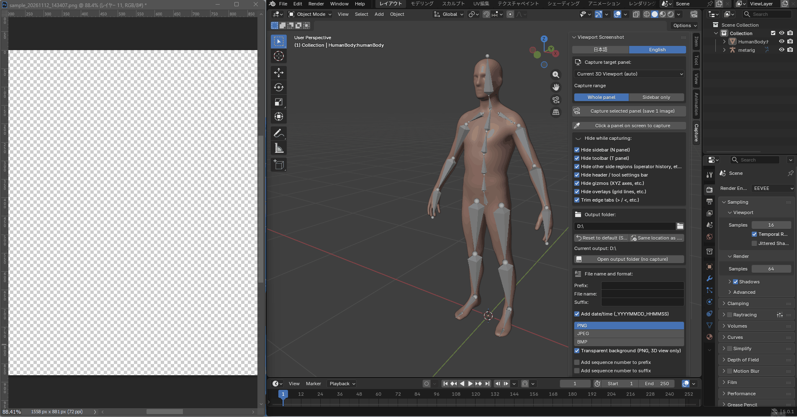

# Viewport Screenshot for Blender (Free Edition)

> **Capture clean Blender viewports in one click — no manual UI hiding or cropping required.**

A lightweight, zero-dependency Blender add-on to capture clean 3D viewport screenshots with a single click.

🔥 **Launch Sale Active (until Nov 29):**
Check out the **Pro Edition** (with **Transparent Background / Alpha PNG** capture & **Direct Clipboard Copy `Ctrl+V`**) on [Gumroad (Global)](https://mashitaya.gumroad.com/l/tdgmq/LAUNCH) or [BOOTH (Japan)](https://yworks.booth.pm/items/9112055).

---

## ⚡ Features (Free Edition)

* **One-Click Clean Capture:** Snap your active 3D Viewport from the top-right header camera icon or the Sidebar (`N` key > **Capture** tab).
* **Auto-Hide UI Clutter:** Temporarily hides sidebars, headers, and overlays while capturing, then restores your workspace automatically.
* **Zero External Dependencies:** Built purely on Blender's native Python API (no extra packages needed).
* **Lightweight & Portable:** Single `.py` add-on file—easy to install and use.
* **Compatibility:** Tested on **Blender 3.2 and newer (Blender 3.2 – 5.x)** on Windows, macOS, and Linux.

## 🚀 How to Install & Use

Since the Free Edition is provided as a standalone Python add-on (`viewport_screenshot_blender_free.py`), follow these steps to install it in Blender:

1. Download [`viewport_screenshot_blender_free.py`](./viewport_screenshot_blender_free.py) from this repository.
   *(If you downloaded the repository as a ZIP via **Code > Download ZIP**, extract it first so you can select the `.py` file).*
2. Open Blender and go to **Edit > Preferences > Add-ons**.
3. Click **Install...** at the top right.
   *(In **Blender 4.2 and newer**, click the top-right down-arrow icon `v` > **Install from Disk...**).*
4. Navigate to the downloaded `viewport_screenshot_blender_free.py` and click **Install Add-on**.
5. Enable the checkbox next to **3D View: Viewport Screenshot**.
6. Click the **camera icon** in the top-right header of the 3D Viewport (or open **Sidebar `N` > Capture**) to take a clean screenshot!

## ⚖️ Free vs. Pro Comparison

| Feature | Free Edition | Pro Edition |
| :--- | :---: | :---: |
| One-Click 3D Viewport Capture | ✅ | ✅ |
| Basic Auto-Hide UI & Overlays | ✅ | ✅ |
| **Transparent Background (Alpha PNG Cutout)** | ❌ | ✅ |
| **Direct OS Clipboard Copy (`Ctrl+V` into Photoshop/Discord)** | ❌ | ✅ |
| **Capture Any Panel, Click-to-Pick Panel & Sidebar Only** | ❌ | ✅ |
| **Auto-Trim Edge Fold Tabs (`>` / `<` / `v`)** | ❌ | ✅ |
| **Custom File Naming, Timestamps, Sequences & `.blend` Preset** | ❌ | ✅ |
| **Bilingual UI (English / Japanese)** | ❌ | ✅ |
| Lifetime Updates & Priority Support | Community | ✅ |

👉 **Upgrade to Pro (Sale until Nov 29):** [Gumroad](https://mashitaya.gumroad.com/l/tdgmq/LAUNCH) | [BOOTH (国内向け)](https://yworks.booth.pm/items/9112055)

## 📄 License & Terms

* **Usage:** Free for both non-commercial and commercial 3D modeling, animation, and rendering workflows.
* **Restrictions:** Redistribution, resale, or sublicensing of this script/source code is strictly prohibited.

---

## 🇯🇵
